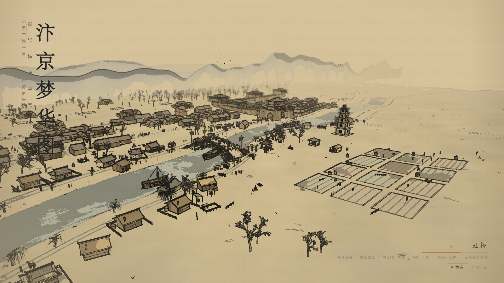

# 汴京梦华图 · 水墨三维长卷

**[▶ 在线观展](https://focuzhe.github.io/bianjing-menghua/)**

用 three.js 以张择端《清明上河图》的构图为底本，重建北宋汴京汴河两岸的景色。
取名「汴京梦华图」——「汴京」是北宋都城，「梦华」取意《东京梦华录》。

整体走**绢本水墨**而不是写实渲染：画面里的每一根线、每一块墨、每一处留白，
都由一套自定义后期管线"画"出来，而不是贴一张水墨滤镜。

## 操作

| 操作 | 效果 |
| --- | --- |
| 拖拽 | 绕卷轴中心旋转视角 |
| 滚轮 | 远近推拉（22 ~ 460） |
| **W / A / S / D** | 平移视点（按住持续移动，方向随当前朝向）。W 后退、S 前进 |
| **Q / E** | 降低 / 升高视点 |
| **Shift** | 平移加速 3 倍 |
| 空格 | 切换自动游览（沿汴河从郊野走到街市，循环） |
| M 或点右下「动态 / 静态」 | 切换画面动效（水流、人物手脚摆动、树梢随风、飞鸟、纸纹流动） |

## 画里有什么

- **汴河**：蜿蜒河道，水面是几道细墨线（不是高光波纹）。
- **虹桥**：木拱桥、栏杆、桥下一艘大船正在放桅过桥；桥面只留 14 个行人与 7 个趴在栏杆上看船的人，
  引道两侧 13×30 米内连柳树都清掉，让桥体本身是一条完整的拱线。
- **城门与街市**：券门 + 城台 + 重檐城楼，城门内 10 余间店铺，彩楼欢门与酒旗。
- **近景田畴**：12 块田（4×3）排成对齐的棋盘，逐点贴地 + 垄台 + 五剖面田埂，
  外加弯曲水渠、两座小桥、稻草人、草垛、耕牛与犁、篱笆。
- **河畔点景**：五级宝塔（放大 1.4 倍、总高约 19 米）、临水亭、水磨坊、凉亭、石塔、驿亭、望柱石灯。
- **北岸城郭街坊**：147 栋（沿街店屋 + 院落民居 + 二层酒楼 / 牌坊 / 巷门），每栋按 3×3 足迹采样地形高度落台基。
- **东侧市集**：沿土路两侧铺开的摊带 + 仓房 + 车马牲畜 + 赶集人群。
- **人畜**：约 430 个人物剪影、约 70 头牲畜；分布重心在城内街巷与市集，
  人物沿 district.js / market.js 自己让出来的街道走廊布点，不会穿墙。
- **飞鸟**：19 只 / 3 群，全部飞行与扇翅在顶点着色器里算，1 个 draw call。
- **植被**：柳、枯树、芦苇、远景树丛、灌丛。
- **远山**：3 层山脊薄片，脊线一带着浓墨，往下化开，山脚没入云气。

## 水墨后期管线

场景先是一次普通的 three.js 渲染，然后被这套管线"重画"一遍：

1. **颜色 + 深度** → HalfFloat RT；**法线** → 单独的 RT
2. 合成 pass 里依次做：`toSRGB()` → 按深度渐进虚焦 → **墨线提取**（深度 Roberts cross + 法线差分 + 亮度差分）
   → 毛笔提按 / 飞白 / 积墨晕开 → **披麻皴** → 点苔、墨分五色（量化）、留白 →
   贴地雾霭 → 大气退晕 → 纸纹 + 暗角

关键约束：**画面里没有比纸更亮的东西**。纸纹只压暗不提亮，非天空区一律 `min(color, paper)`。

### 几个踩过的坑

- **两个离屏 RT 都开 4× MSAA**：一根树枝在屏幕上都只有 1~2 px，不做亚像素平均就是满地噪点。
- **线密度自适应**：镜头拉远时几百栋房子挤进几十个像素，每个像素都判定成边缘 → 糊成一坨黑。
  统计 8 邻域内也是边缘的像素比例，密集处主动减墨。
- **地面笔触图的 `flipY`**：笔触图按世界坐标直接采样，而 `CanvasTexture` 默认 `flipY = true`，
  等于把整张图上下翻过来 —— 南岸的田垄跑到北岸、北岸城郭的院墙跑到南岸近景。关掉 `flipY` 后地画才对得上。
- **近景不画 2D 犁沟**：掠射角下 1px 的细线会被 mip 放大成粗灰带（像脚手架），
  近景的田交给真几何，笔触图只管中远景肌理。

## 动效

全部在 GPU：CPU 每帧只改一个 `uTime`。

| 什么在动 | 做法 |
| --- | --- |
| 水面 | 水纹 shader 里按 `uTime` 平移噪声采样，等值线取墨 |
| 人物走动 | 合批成一个 mesh，`aWalk`/`aAnchor` 记录方向、幅度、相位，顶点着色器里 sin 踱步 + 抬脚 |
| 人物手脚 | `aLimb` + `aPivot`，每顶点绕自己的关节做 Rodrigues 旋转，腿与同侧手臂反相摆 |
| 树与草 | `makeInkMaterial({ wind })` 按"离地高度的 1.35 次幂"衰减摆幅，三个频率叠加 + 低频阵风包络 |
| 飞鸟 | `aBird`/`aOrbit`/`aPart`，顶点着色器里算椭圆盘旋 + 折翼扇翅 |
| 纸纹 | `inkPost` 里毛笔噪声按 `uTime` 缓慢平移 |

## 性能

单文件 HTML，无外部依赖，不联网。真机实测（AMD Radeon 880M / Chrome D3D11 / 1582×804）：

| 项 | 值 |
| --- | --- |
| 帧间隔中位数 | 15.0 ms → 67 fps |
| 第 90 百分位 | 20.3 ms → 49 fps |
| 场景规模 | 96 mesh / 约 250 万三角形 / 26 个顶层 group |

跑不动时会自动降 pixelRatio（90 帧后平均 > 34 ms → 1.0，> 62 ms → 0.75）。

## License

代码与画面由本仓库作者用 three.js 生成，可自由浏览、引用与二次创作，注明出处即可。
《清明上河图》原作属公有领域。
